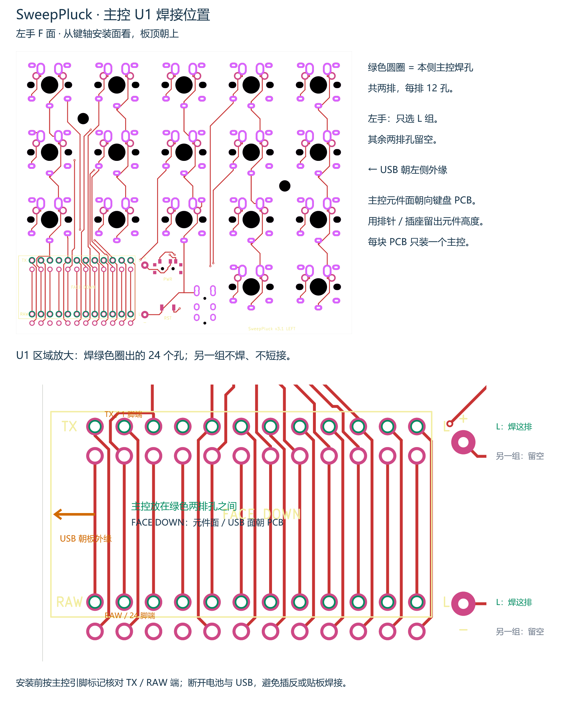
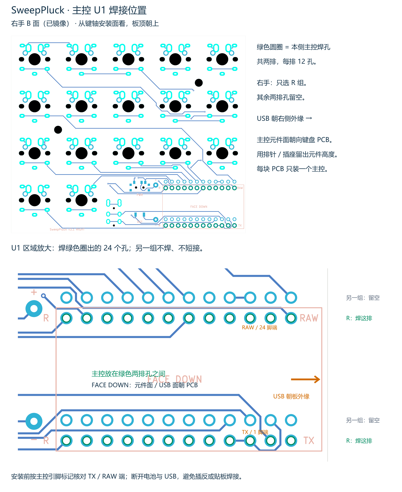

# 主控 U1 焊接位置

图中绿色圆圈为所选装配方式使用的 24 个主控孔，每排 12 孔。另一组两排留空，不短接。图从键轴安装面观察，板顶朝上。

## 左手 F 面：L 组，USB 朝左侧外缘

[SVG 矢量图](mcu_board_LEFT.svg)

## 右手 B 面：R 组，USB 朝右侧外缘

[SVG 矢量图](mcu_board_RIGHT.svg)

主控位于两排绿色孔之间，元件面及 USB 插座所在面朝向键盘 PCB（FACE DOWN）。通过排针或插座留出元件和 USB 外壳所需高度，不要贴板焊接。每块 PCB 只安装一个主控。

断开电池与 USB 后操作。安装前按模块引脚标记核对图示 TX / RAW 两端；主控型号不同，供电和充电要求需按实际模块核对。图中的 TX 是接口端位置标记，当前 PCB 对应 U1 的 1 脚网络为 Switch10。

底图来自当前 KiCad 导出的实际 F/B 面 SVG，焊孔坐标及 L/R 组别读取自 `SweepPluck-pins.csv`，每侧核对 24 个不同引脚。运行 `python SweepPluck/tools/mcu_board_guide.py` 可重新生成 SVG，PNG 使用 resvg 从同名 SVG 渲染。
