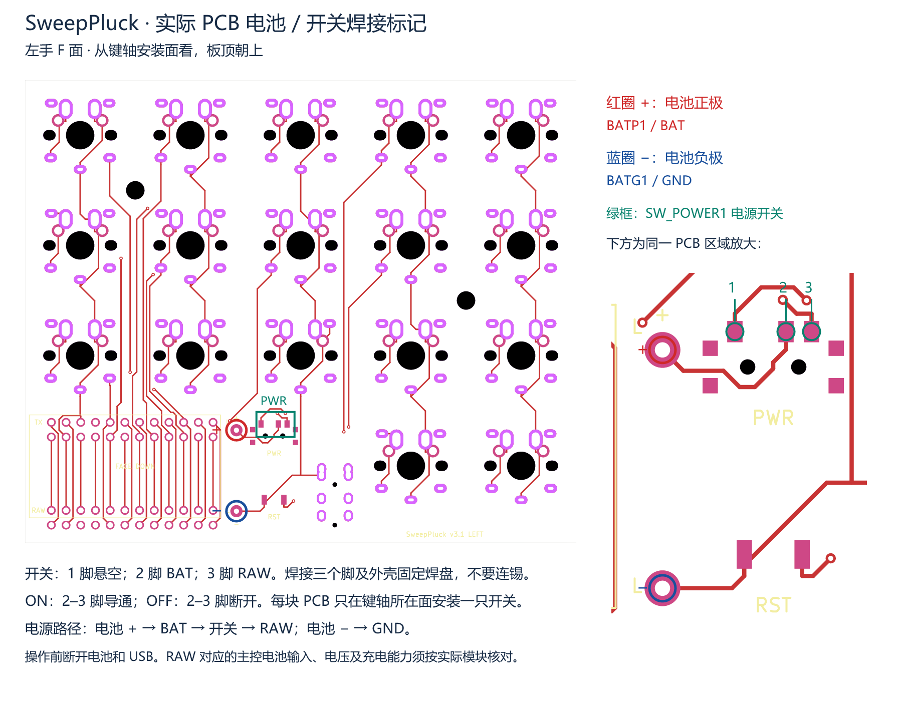
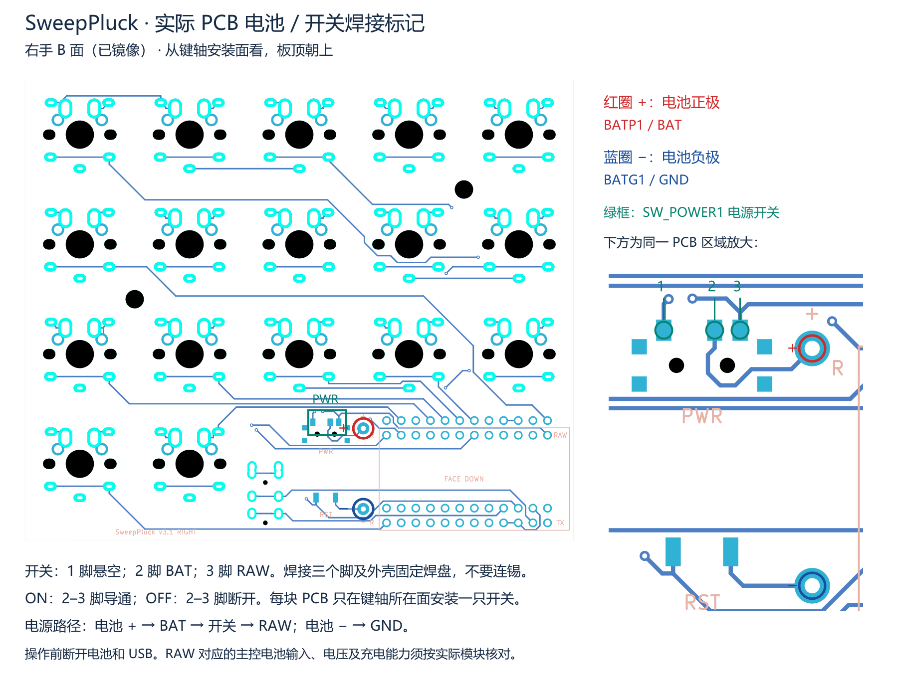

# 电池与电源开关焊接

适用于当前 SweepPluck v3.1 可翻面 PCB。下图从**键轴安装面**观察，主键区在上、主控区域在下；右手图已镜像，不要再自行镜像。

## 左手：F 面朝上

[查看矢量图](power_board_LEFT.svg) · [简化焊盘图](power_LEFT.png)

## 右手：B 面朝上

[查看矢量图](power_board_RIGHT.svg) · [简化焊盘图](power_RIGHT.png)

主图直接使用 KiCad 导出的实际 F/B 面 PCB 示意图，红圈标电池正极，蓝圈标负极，绿框标电源开关；右侧为同一电源区域的放大图，标出开关 1、2、3 脚。标记坐标读取自 `SweepPluck-pins.csv`，右手使用镜像坐标。图不用于尺寸测量，也不表示 PCB 的全部铜层。

## 焊接顺序

1. 断开 USB 和电池。左手在 F 面装配，右手在 B 面装配；每块板只装一只 `SW_POWER1`。先确认开关的引脚间距、固定脚和定位柱与封装吻合。
2. 对齐开关的三个电气脚，先点焊一脚固定，检查位置后再焊其余两脚及外壳固定焊盘。1 脚网络悬空，2 脚为 BAT，3 脚为 RAW；三个脚都焊到各自焊盘，不要用锡桥连接。灰色固定焊盘不用于接电池线，定位孔不焊。
3. 不接电池，用万用表核对拨动开关时 **2–3 脚在导通与断开之间切换**。导通位置为 ON，断开位置为 OFF；不依据拨杆朝向猜测状态。清除相邻焊盘锡桥。
4. 核对电池线的实际极性，再将正极线焊到 `BATP1 / BAT`，负极线焊到 `BATG1 / GND`。通常红线为正、黑线为负，但以实测或电池标记为准。两个电池焊孔都是通孔，正反面对应同一网络。
5. 裸露接头绝缘，导线留出余量并固定，避免拉力作用于焊盘。装电池前检查 BAT 对 GND 没有持续短路，并复核主控的供电要求。

## 电源路径与主控限制

`电池正极 → BATP1（BAT）→ SW_POWER1 的 2–3 脚 → RAW → 主控`

`电池负极 → BATG1（GND）→ 主控 GND`

`RAW` 是这块 PCB 的网络名，不代表所有 Pro Micro 兼容主控都能使用同一种电池。请按实际主控文档核对该位置对应的电池输入、电压范围及充电功能。PCB 本身没有独立充电电路；不得把电池正极改接到 VCC，也不要短接 BAT 与 RAW 来代替开关。该开关只切换 BAT 到 RAW 的通路，OFF 不保证 USB 等其他电源已断开。

本文仅补充装配说明，没有修改 PCB、电路或生产 Gerber。图可运行 `python SweepPluck/tools/power_guide.py` 重新生成（需要 Pillow 和微软雅黑字体）。

实际 PCB 标注矢量图可运行 `python SweepPluck/tools/power_board_guide.py` 重新生成；PNG 可用 SVG 渲染器（如 resvg）从同名 SVG 导出。

